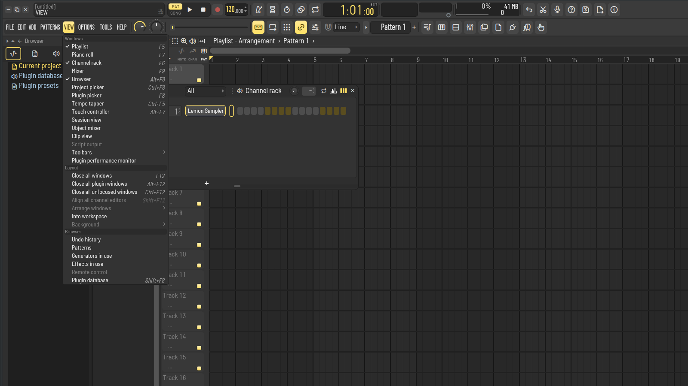
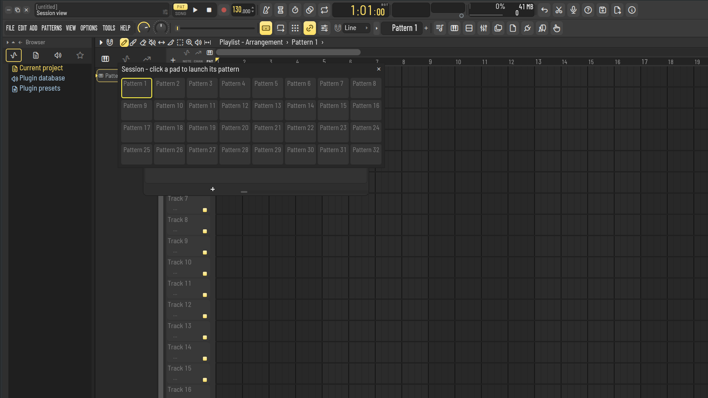
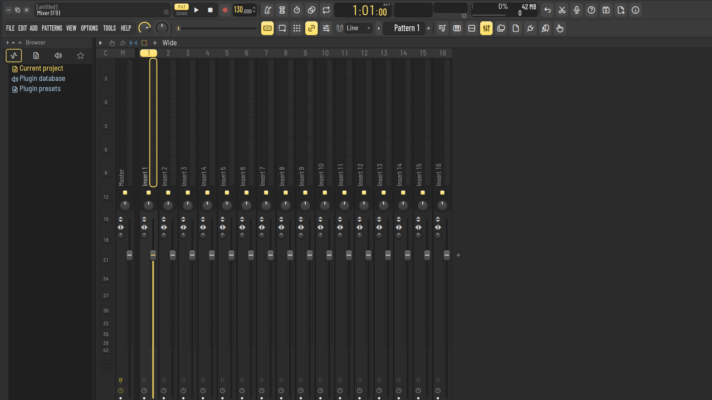

# Tutorial de Xadaw

Video: `tutorial.mp4` · Subtitulos: `tutorial.srt`

## Paso 1

Abre el menu VIEW

## Paso 2

Elige Session view: pads para lanzar patrones

## Paso 3

Ahora abre el mixer con su boton de la barra

## Guion completo

- `0:00` Bienvenido a Xadaw: te muestro la vista Session y el mezclador.
- `0:05` Abre el menu VIEW
- `0:08` Elige Session view: pads para lanzar patrones
- `0:13` Ahora abre el mixer con su boton de la barra
- `0:18` Abajo del mixer esta la vista de dispositivos de la pista seleccionada.
